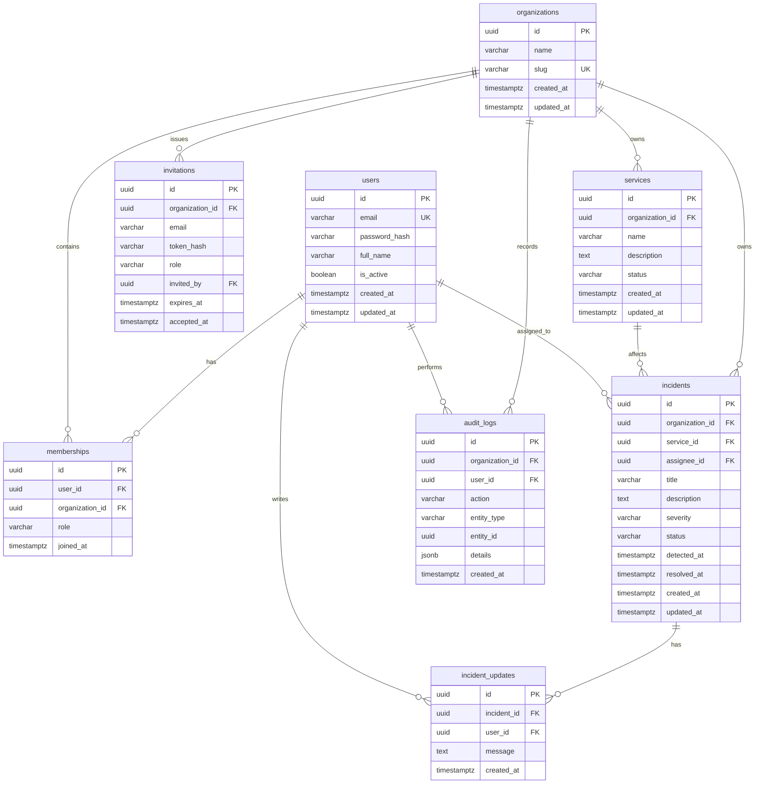

# OpsHub — Database Design

## 1. Overview

OpsHub uses PostgreSQL as its primary relational database.

The database follows a shared-database, shared-schema multi-tenant architecture. Multiple organizations share the same database infrastructure while organization-owned records remain logically isolated.

SQLAlchemy will manage database access, and Alembic will manage schema migrations.

### Design Objectives

- Maintain referential integrity.
- Enforce organization-level data ownership.
- Support users belonging to multiple organizations.
- Prevent cross-organization data access.
- Maintain incident investigation history.
- Record important administrative and security activities.
- Support efficient queries through appropriate indexes.

## 2. Database Conventions

| Property | Convention |
|---|---|
| Database | PostgreSQL |
| Primary keys | UUID |
| Identifier generation | Application-generated UUID |
| Table names | Singular or plural consistently, lowercase snake_case |
| Column names | snake_case |
| Timestamps | TIMESTAMPTZ |
| Primary key column | id |
| Foreign key naming | referenced_entity_id |
| Soft deletion | Only where business requirements justify it |

All timestamps will be stored in UTC.

Application responses may convert timestamps into the user's preferred timezone.

## 3. Entity Relationship Overview

## 4. Table Specifications

### 4.1 users

Stores application-wide user accounts.

| Column | Type | Constraints |
|---|---|---|
| id | UUID | Primary key |
| email | VARCHAR(255) | Unique, not null |
| password_hash | VARCHAR(255) | Not null |
| full_name | VARCHAR(150) | Not null |
| is_active | BOOLEAN | Not null, default true |
| created_at | TIMESTAMPTZ | Not null |
| updated_at | TIMESTAMPTZ | Not null |

Rules:

- Email addresses must be normalized before storage.
- Passwords must be hashed using Argon2id.
- Passwords must never be stored in plaintext.
- Deactivating a user must prevent future authentication.

### 4.2 organizations

Stores tenant organizations.

| Column | Type | Constraints |
|---|---|---|
| id | UUID | Primary key |
| name | VARCHAR(150) | Not null |
| slug | VARCHAR(100) | Unique, not null |
| created_at | TIMESTAMPTZ | Not null |
| updated_at | TIMESTAMPTZ | Not null |

Rules:

- Each organization has a unique slug.
- Organization records own their services, incidents, memberships and invitations.
- Organization deletion must follow an explicitly designed retention policy.

### 4.3 memberships

Connects users to organizations.

| Column | Type | Constraints |
|---|---|---|
| id | UUID | Primary key |
| user_id | UUID | Foreign key to users |
| organization_id | UUID | Foreign key to organizations |
| role | VARCHAR(30) | Not null |
| joined_at | TIMESTAMPTZ | Not null |

Allowed roles:

- admin
- responder
- viewer

Constraints:

- Unique combination of user_id and organization_id.
- A user can belong to multiple organizations.
- Organization-specific permissions are derived from membership.
- A user's role in one organization does not grant access to another organization.

### 4.4 invitations

Stores pending organization membership invitations.

| Column | Type | Constraints |
|---|---|---|
| id | UUID | Primary key |
| organization_id | UUID | Foreign key to organizations |
| email | VARCHAR(255) | Not null |
| token_hash | VARCHAR(255) | Unique, not null |
| role | VARCHAR(30) | Not null |
| invited_by | UUID | Foreign key to users |
| expires_at | TIMESTAMPTZ | Not null |
| accepted_at | TIMESTAMPTZ | Nullable |
| created_at | TIMESTAMPTZ | Not null |

Rules:

- Store only a hash of the invitation token.
- Invitations must expire.
- Invitations can only be accepted once.
- The invited email and authenticated user identity must be validated.
- The inviter must have permission to invite members.

### 4.5 services

Represents an organization's applications, infrastructure components or operational services.

| Column | Type | Constraints |
|---|---|---|
| id | UUID | Primary key |
| organization_id | UUID | Foreign key to organizations |
| name | VARCHAR(150) | Not null |
| description | TEXT | Nullable |
| status | VARCHAR(30) | Not null |
| created_at | TIMESTAMPTZ | Not null |
| updated_at | TIMESTAMPTZ | Not null |

Initial service statuses:

- operational
- degraded
- partial_outage
- major_outage
- maintenance

Constraints:

- Service names should be unique within an organization.
- A service must always belong to one organization.

### 4.6 incidents

Stores operational incidents.

| Column | Type | Constraints |
|---|---|---|
| id | UUID | Primary key |
| organization_id | UUID | Foreign key to organizations |
| service_id | UUID | Foreign key to services |
| assignee_id | UUID | Nullable foreign key to users |
| title | VARCHAR(200) | Not null |
| description | TEXT | Nullable |
| severity | VARCHAR(10) | Not null |
| status | VARCHAR(30) | Not null |
| detected_at | TIMESTAMPTZ | Not null |
| resolved_at | TIMESTAMPTZ | Nullable |
| created_at | TIMESTAMPTZ | Not null |
| updated_at | TIMESTAMPTZ | Not null |

Initial severity values:

- SEV1
- SEV2
- SEV3
- SEV4

Initial status values:

- investigating
- identified
- monitoring
- resolved

Rules:

- Every incident belongs to exactly one organization.
- The affected service must belong to the same organization.
- An assigned user must be an authorized member of the incident's organization.
- Resolved incidents must have a resolution timestamp.
- Unresolved incidents must not have a resolution timestamp.
- Status transitions must follow backend business rules.

### 4.7 incident_updates

Stores investigation comments and timeline entries.

| Column | Type | Constraints |
|---|---|---|
| id | UUID | Primary key |
| incident_id | UUID | Foreign key to incidents |
| user_id | UUID | Foreign key to users |
| message | TEXT | Not null |
| created_at | TIMESTAMPTZ | Not null |

Rules:

- Every update belongs to an incident.
- The author must have permission to access that incident.
- Updates are append-only in the initial MVP.
- Editing or deleting historical updates is not supported initially.

### 4.8 audit_logs

Records important organizational actions.

| Column | Type | Constraints |
|---|---|---|
| id | UUID | Primary key |
| organization_id | UUID | Foreign key to organizations |
| user_id | UUID | Nullable foreign key to users |
| action | VARCHAR(100) | Not null |
| entity_type | VARCHAR(100) | Nullable |
| entity_id | UUID | Nullable |
| details | JSONB | Nullable |
| created_at | TIMESTAMPTZ | Not null |

Examples of recorded actions:

- organization.created
- member.invited
- member.role_changed
- service.created
- incident.created
- incident.assigned
- incident.resolved

Rules:

- Audit records should be append-only.
- Sensitive information, passwords and authentication tokens must never be recorded.
- Audit queries must be organization-scoped.
- System-generated actions may have a null user_id.

## 5. Multi-Tenant Data Isolation

Organization-owned tables must contain organization ownership information directly or through a carefully enforced parent relationship.

### Tenant Isolation Requirements

1. Authenticate the requesting user.
2. Resolve the requested organization context.
3. Verify active membership in that organization.
4. Determine the user's organization-specific role.
5. Scope every database query to the authorized organization.
6. Validate ownership when linking related records.
7. Reject unauthorized cross-organization requests.

### Database-Level Protection

Composite foreign keys will be used where appropriate to enforce tenant consistency.

For example:

- services will have a unique constraint on (organization_id, id).
- incidents will reference services using (organization_id, service_id).
- memberships will have a unique constraint on (organization_id, user_id).

This prevents an incident belonging to one organization from referencing a service belonging to another organization.

PostgreSQL Row-Level Security may be evaluated as an additional defense-in-depth measure. It will not replace application authorization.

## 6. Indexing Strategy

Initial indexes will include:

| Table | Index | Purpose |
|---|---|---|
| users | email | Authentication lookup |
| organizations | slug | Organization lookup |
| memberships | user_id, organization_id | Membership lookup |
| services | organization_id | Tenant service listing |
| incidents | organization_id, status | Incident dashboard filtering |
| incidents | organization_id, severity | Severity filtering |
| incidents | organization_id, created_at | Incident history |
| incidents | organization_id, assignee_id | Assigned incidents |
| incident_updates | incident_id, created_at | Incident timeline |
| audit_logs | organization_id, created_at | Audit history |
| invitations | token_hash | Invitation verification |

Indexes will be adjusted based on query patterns and actual performance measurements.

## 7. Data Integrity and Constraints

The database will enforce:

- Primary key uniqueness.
- Foreign key relationships.
- Unique organization slugs.
- Unique normalized user emails.
- Unique user-organization memberships.
- Valid role and severity values.
- Valid service statuses.
- Valid incident statuses.
- Organization consistency across related records.
- Valid resolution timestamp combinations.

Database constraints and backend validation will complement one another.

## 8. Transaction Management

Related operations must be executed transactionally.

Examples:

- Creating an organization and its initial admin membership.
- Accepting an invitation and creating a membership.
- Resolving an incident and recording its timeline update.
- Changing an incident assignment and recording the corresponding audit event.

If an operation fails, the transaction must roll back to avoid partially applied changes.

## 9. Deletion and Retention

Initial MVP policy:

- Historical incident updates should be retained.
- Audit logs should be retained.
- Organization deletion must not be exposed as an ordinary destructive operation.
- User deactivation should be preferred over immediate account deletion where historical attribution is needed.
- Foreign key deletion behavior must be explicitly configured.

Retention and account deletion policies will be reviewed before production deployment.

## 10. Migration Strategy

Alembic will manage all database schema changes.

Rules:

1. Every schema change must have a migration.
2. Migrations must be reviewed before deployment.
3. Destructive migrations require explicit review.
4. Production migrations must have a documented recovery strategy.
5. The application must not silently create or modify production tables at startup.

## 11. Future Database Enhancements

Potential future additions include:

- Notification preferences.
- Incident attachments.
- Service dependencies.
- Incident subscribers.
- On-call schedules.
- Webhook delivery records.
- External alert integrations.
- Subscription and billing records.

These will be added only when supported by actual product requirements.

---

**Document:** Database Design
**Project:** OpsHub
**Repository:** saas-incident-management
**Status:** Initial database design baseline
